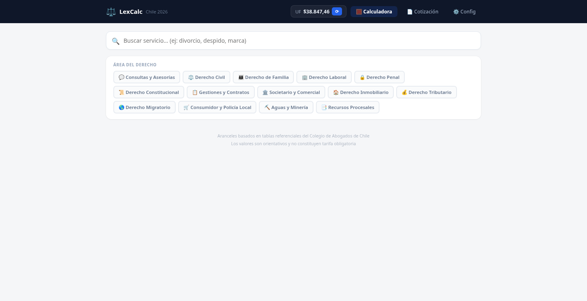

# LexCalc — Legal Fee Calculator for Chile

[](https://olxman.github.io/calculadora-abogados/)
[](LICENSE)
[](https://react.dev/)

Free, open-source web app that helps lawyers and small law firms in Chile calculate legal fees in UF and generate professional PDF quotes.

The calculator runs as a **single HTML file**. There is nothing to install. It is used in production by the Chilean law firm [Subiabre Abogados](https://olxman.github.io/calculadora-abogados/).

**[Open the live demo](https://olxman.github.io/calculadora-abogados/)**

> **Disclaimer:** Fee ranges are referential estimates for planning and quoting. The app describes them as indicative tables based on referential schedules of the Colegio de Abogados de Chile, not a mandatory tariff. They are not a promise of results or legal advice. Always review the quote with the responsible attorney before sending it to a client.

---

## Features

- **Fee calculator** covering 14 areas of Chilean law and 135 referential services
- Amounts quoted in **UF**, converted to CLP using the official UF value
- **Automatic UF update** from the [mindicador.cl](https://mindicador.cl) API, with manual override if the API is unavailable
- **Complexity** multiplier (Low 0.8×, Medium 1.0×, High 1.3×, Very High 1.6×) and a slider to pick a position inside the min–max UF range
- **Quote builder**: add catalog services or manual lines (UF or CLP, including pro bono / 0), client data, and notes
- **Professional PDF quotes** (print-to-PDF) with firm name, logo, and letterhead
- **Firm settings**: name, tax ID, address, phone, email, and logo
- Works in the browser on desktop and mobile — no server and no build step

## Legal areas

| Area | Examples of services |
|------|----------------------|
| Consultations & advice | Online or in-person consults, written opinions, retainers, due diligence |
| Civil law | Ordinary, summary and executive proceedings, leases, damages |
| Family law | Divorce, child support, custody, visitation, domestic violence, filiation |
| Labor law | Unfair dismissal, ordinary and monitorio claims, tutelage, union matters |
| Criminal law | Oral trial defense, abbreviated procedures, complaints, detention hearings |
| Constitutional law | *Recurso de protección*, *amparo*, Constitutional Court actions |
| Filings & contracts | Title searches, contract drafting, wills, *posesión efectiva* |
| Corporate & commercial | Company formation, dissolution, insolvency, trademarks (INAPI) |
| Real estate | Purchase and sale, mortgages, regularization, co-ownership |
| Tax law | Tax claims, SII audits, payment agreements |
| Immigration law | Work visas, temporary or permanent residence, nationality |
| Consumer & local police | Consumer actions, SERNAC complaints, class actions |
| Water & mining | Water-right regularization, mining property |
| Procedural remedies | Appeal, cassation, criminal or labor nullity, *recurso de queja* |

## Screenshots

### Calculator



## How to run

### Option 1 — Open the file

Open `index.html` in a modern browser (Chrome, Firefox, Edge, or Safari).

### Option 2 — Clone and serve locally

```bash
git clone https://github.com/olxman/calculadora-abogados.git
cd calculadora-abogados
python3 -m http.server 8080
```

Then visit [http://localhost:8080](http://localhost:8080).

This repository is a standalone page (React 18 loaded from a CDN). There is no `package.json` and you do not need Node.js or `npm install` to use it.

## Project structure

```
calculadora-abogados/
├── index.html                 # The app (calculator, quotes, settings)
├── CODIGO-FUENTE-PRECIOS.js   # Reference copy of an earlier CLP fee table (not loaded by the live app)
├── calculadora-abogados-chile.zip
├── LICENSE                    # MIT
├── README.md
├── CONTRIBUTING.md
├── CODE_OF_CONDUCT.md
├── SECURITY.md
├── CHANGELOG.md
├── GUIA-GITHUB.md             # Spanish guide to publish a fork on GitHub Pages
└── .github/workflows/static.yml  # Deploy to GitHub Pages
```

The live app reads fee tables embedded in `index.html`. `CODIGO-FUENTE-PRECIOS.js` is kept as a reference snapshot of an earlier configuration; changing it does not change the calculator until those values are ported into `index.html`.

## Configuration

1. Open the app and go to **Configuración**.
2. Fill in the firm name, tax ID, address, phone, email, and optional logo. These fields appear on the PDF quote.
3. Click **Actualizar UF** to pull the current official value, or type it manually.

Settings live in the current browser session. If you refresh the page, values fall back to the defaults stored in `index.html`.

## Deploy your own copy on GitHub Pages

1. Fork [olxman/calculadora-abogados](https://github.com/olxman/calculadora-abogados).
2. In the fork, go to **Settings → Pages** and set the source to **GitHub Actions**.
3. The workflow in `.github/workflows/static.yml` publishes the site after each push to `main`.
4. Your copy will be available at `https://<your-username>.github.io/calculadora-abogados/`.

A longer, step-by-step walkthrough in Spanish is in [GUIA-GITHUB.md](GUIA-GITHUB.md).

## Contributing

Bug reports, fee-table corrections, and documentation improvements are welcome. Please read [CONTRIBUTING.md](CONTRIBUTING.md) and the [Code of Conduct](CODE_OF_CONDUCT.md) before opening a pull request.

## Roadmap

- Keep referential fee ranges current
- Automated checks and a clearer contribution path for fee-table updates
- Accessibility and mobile UX improvements
- Optional English UI
- Notes on adapting the tool to other Latin American jurisdictions

## License

[MIT](LICENSE) © 2025-2026 Pablo Riquelme (olxman). Free for personal and commercial use.

## Maintainer

Built and maintained by [Pablo Riquelme](https://github.com/olxman) (@olxman), a Chilean commercial engineer, in collaboration with Subiabre Abogados.

Questions or suggestions: open an [issue](https://github.com/olxman/calculadora-abogados/issues).

---

# LexCalc — Calculadora de honorarios legales para Chile

Aplicación web gratuita y de código abierto para que abogados y estudios jurídicos en Chile calculen honorarios en UF y generen cotizaciones PDF profesionales.

Funciona como un **único archivo HTML**, sin instalación. Se usa en producción en el estudio [Subiabre Abogados](https://olxman.github.io/calculadora-abogados/).

**[Abrir la demo en vivo](https://olxman.github.io/calculadora-abogados/)**

> **Aviso:** Los rangos de honorarios son estimaciones referenciales para planificar y cotizar. La propia app indica que se basan en tablas referenciales del Colegio de Abogados de Chile y que los valores son orientativos, no una tarifa obligatoria. No son una promesa de resultado ni asesoría jurídica. Revisa siempre la cotización con el abogado responsable antes de enviarla a un cliente.

## Características

- Calculadora de honorarios con **14 áreas del derecho chileno** y **135 servicios referenciales**
- Valores en **UF**, convertidos a pesos con el valor oficial
- **UF automática** desde la API de [mindicador.cl](https://mindicador.cl), con ingreso manual si la API no responde
- Factor de **complejidad** (Baja 0,8×, Media 1,0×, Alta 1,3×, Muy alta 1,6×) y un control para elegir la posición dentro del rango
- Armado de **cotización**: servicios del catálogo o líneas manuales (UF o pesos, incluso pro bono / 0), datos del cliente y notas
- **PDF profesional** (imprimir a PDF) con datos y logo del estudio
- Funciona en el navegador, en computador o celular, sin servidor ni paso de compilación

## Cómo usarla en tu computador

Abre `index.html` en el navegador, o clona el repositorio y sírvelo en local:

```bash
git clone https://github.com/olxman/calculadora-abogados.git
cd calculadora-abogados
python3 -m http.server 8080
```

Luego entra a [http://localhost:8080](http://localhost:8080). No necesitas Node.js ni `npm install`.

## Publicar tu propia copia

1. Haz un fork de [olxman/calculadora-abogados](https://github.com/olxman/calculadora-abogados).
2. En **Settings → Pages**, elige **GitHub Actions** como origen.
3. El flujo en `.github/workflows/static.yml` publica el sitio con cada cambio en `main`.
4. Tu copia quedará en `https://<tu-usuario>.github.io/calculadora-abogados/`.

La guía paso a paso está en [GUIA-GITHUB.md](GUIA-GITHUB.md).

## Licencia y contacto

Licencia [MIT](LICENSE) © 2025-2026 Pablo Riquelme (olxman). Mantenido por [Pablo Riquelme](https://github.com/olxman). Para ideas o problemas, abre un [issue](https://github.com/olxman/calculadora-abogados/issues).
